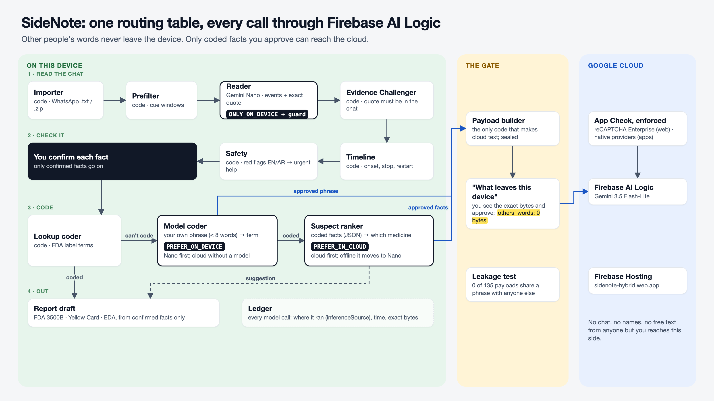

# SideNote

**A suspected side-effect report, with the dates you forgot, read from your family chat on your own device.**

When a medicine might be causing a problem, a regulator's report (FDA MedWatch 3500B, the UK Yellow Card, Egypt's Drug Authority) asks for dates nobody remembers: when the medicine started, when the problem began, whether it went away after stopping and came back after restarting. Those dates are usually already in the family WhatsApp chat ("started the new pill tonight", "my legs ache since Saturday"). SideNote reads that chat **on the device** with Gemini Nano through Firebase AI Logic, builds a dated timeline the person confirms fact by fact, and fills the report. Other people's words never leave the device.

Built for #BuildHybridAI 2026. Not medical advice, not a diagnosis.

**Try it:** https://sidenote-hybrid.web.app (Chrome; with Gemini Nano the chat is read on your device, without it use the demo case or the 5 questions). The same codebase builds Android and iOS apps with Capacitor (`apps/sidenote/android`, `apps/sidenote/ios`).

## Hybrid inference: one routing table, every call through Firebase AI Logic



All model calls go through [`apps/sidenote/src/ai/route.ts`](apps/sidenote/src/ai/route.ts) (the routing table) and [`apps/sidenote/src/ai/firebase.ts`](apps/sidenote/src/ai/firebase.ts) (`getAI`, `getGenerativeModel` with `InferenceMode`). Each feature uses the mode its data allows:

| Feature | Data it sees | Firebase AI Logic mode | Why |
|---|---|---|---|
| Chat reader | the chat, including other people's messages | `ONLY_ON_DEVICE` behind a guard | other people's words must never reach the cloud; no model here = fail closed, nothing sent |
| Symptom coder | one approved phrase (≤ 8 words) of the patient's own words | `PREFER_ON_DEVICE` | Nano first; automatic cloud fallback on devices without a model |
| Suspect ranker | confirmed, coded facts as JSON (no free text) | `PREFER_IN_CLOUD` | cloud first; offline, the SDK falls back to Nano on its own (tested); runs only with 2+ medicines to compare |

- **The guard** ([`packages/private-evidence/src/on-device-guard.ts`](packages/private-evidence/src/on-device-guard.ts)): the JS SDK sends an `ONLY_ON_DEVICE` request to the cloud when the browser has no `LanguageModel` global, so every private-text call checks availability first and rejects any answer whose `inferenceSource` isn't `on_device`.
- **The payload builder** ([`apps/sidenote/src/ai/payload.ts`](apps/sidenote/src/ai/payload.ts)) is the only code that produces text for a cloud-capable route; only its sealed output can be approved, and the approved bytes are exactly what is sent. The app shows them first ("What leaves this device").
- **The ledger** records where every call ran (`inferenceSource`), its time and size; cloud calls keep the exact data they sent.
- **App Check** (reCAPTCHA Enterprise on the web, App Attest on iOS) is enforced on the Firebase AI Logic API.
- The table also defines an `ONLY_IN_CLOUD` route for the patient's own words (for devices with no on-device model); no screen uses it yet. Without an on-device model the app asks 5 short questions instead.

## Agents

| Agent | Kind | Job |
|---|---|---|
| Importer | code | WhatsApp export (.txt or iOS .zip) to dated messages |
| Prefilter | code | cue windows around medicine and symptom words |
| Reader | Gemini Nano, on device | one window to dated events with a verbatim quote |
| Evidence challenger | code | quote must be found in the chat; questions and "I read it can cause…" are not events |
| Timeline | code | onset, dechallenge, rechallenge; a state machine for medicine starts and stops |
| Lookup coder | code, on device | phrase to a reaction term from public FDA labels |
| Model coder | Nano first, cloud fallback | the phrases the lookup can't code |
| Suspect ranker | Gemini, cloud first (2+ medicines) | which medicine is more likely, with reason codes; code keeps only reasons the data supports |
| Safety | code | red flags (English and Arabic) open urgent help; questions asking for advice get a fixed answer |
| Person | you | confirm every fact, approve every send, approve the report |

## How we know

| Measure | Result | Data |
|---|---|---|
| Chat reading, held-out chats | 43 / 49 dates right; +3.3 needed dates per chat over 5 questions alone [2.2, 4.5]; 0 requests to the AI endpoint while reading | 10 planted chats written by another model family ([evals/chattest](evals/chattest/RESULT.md)) |
| Leakage | 0 shared phrases with other people's messages across 135 payloads and report exports; planted leaks caught | 30 planted chats (`npm run leakage -w @sidenote/app`) |
| Fail-closed routing | no on-device model, or a failing one: the chat reader makes no cloud call | unit tests (`apps/sidenote/test/route.test.ts`) |
| Coder, unseen everyday phrases | lookup 27%, Nano 58%, cloud 72% (both models pass the +0.15 bar) | 179 CADEC research phrases, kept local ([evals/coder](evals/coder/RESULT.md)) |

All chats in this repository are synthetic. CADEC (used only to measure the coder) is not redistributable and is not in this repository.

## Run it

```bash
npm install
# apps/sidenote/.env.local: VITE_FB_API_KEY, VITE_FB_AUTH_DOMAIN, VITE_FB_PROJECT_ID, VITE_FB_STORAGE_BUCKET,
#   VITE_FB_MESSAGING_SENDER_ID, VITE_FB_APP_ID, VITE_RECAPTCHA_SITE_KEY (your Firebase project with AI Logic and App Check)
# apps/sidenote/.env.development.local: VITE_APPCHECK_DEBUG_TOKEN (an App Check debug token, dev only)
npm run dev -w @sidenote/app      # http://localhost:5173
npm test                          # unit tests
npm run build -w @sidenote/app    # type-check and production build
```

On-device reading needs Chrome with Gemini Nano available (`LanguageModel.availability()` returns `available`). Without it the app says so, reads nothing, and offers 5 short questions or the demo case.

## Layout

- `packages/private-evidence`: domain-free core (WhatsApp parser, quote locator, date resolver, on-device guard)
- `apps/sidenote`: the app (React, Ionic, Capacitor), pipeline, routing, payload builder, vocabulary, screens
- `evals`: the chat test and the coder re-measure, with their plans and results

## License

MIT ([LICENSE](LICENSE)). Reaction terms and label excerpts come from public-domain FDA drug labels (openFDA).
